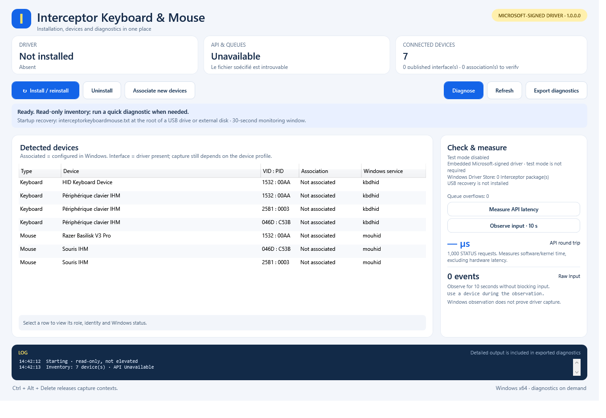
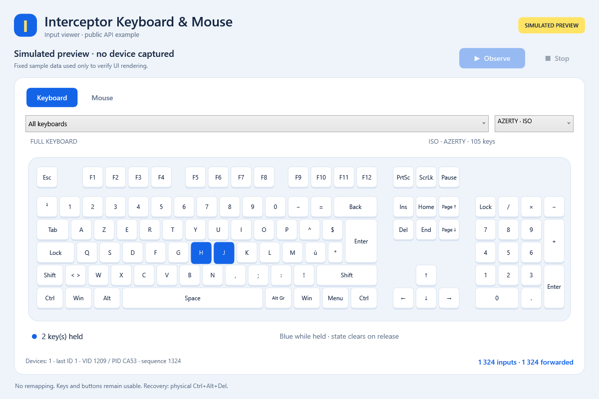

# Interceptor Keyboard & Mouse - Windows Kernel Filter Driver

Capture, remap or block **physical keyboard and mouse input** with a
**Microsoft-signed kernel filter driver** and a **two-file C++17 SDK**.
Identify each source, receive its input and forward your changes through the
device's Windows input path. Requires **Windows 10 1709+ / Windows 11 x64**.

**[Download](https://github.com/TitanCSA/Interceptor-Keyboard-Mouse/releases/latest)** |
[Installation](docs/INSTALLATION.md) | [C++ API](docs/API.md) |
[Examples](ExamplesConsole/README.md) | [Compatibility](docs/COMPATIBILITY.md)

| Setup and diagnostics | Input viewer |
| --- | --- |
|  |  |

Screenshots illustrate the interface; preview inputs are simulated.

<a id="quick-start"></a>

## Install and use

1. Download this repository's **InterceptorSetup.exe** and accept elevation.
2. Choose **Install / reinstall**. Use Windows **Restart** if requested, then
   reopen setup to finish device associations.
3. Run **InterceptorExampleUI.exe** as administrator and click **Observe**.
   **Stop** releases capture. Close other capture applications first.
4. Use **Diagnose** for installation checks and a report you can copy or export.
   Input features that were not exercised remain **unverified**.

The GUI provides **Uninstall**. The console installer uses the same setup engine:

```powershell
.\InterceptorSetupConsole.exe /install
.\InterceptorSetupConsole.exe /uninstall
```

Exit code `3010` requests a restart; rerun `/install` afterward if associations
are pending. The driver package is Microsoft-signed; that signature does not
automatically sign installer or example EXEs. [Recovery](docs/INSTALLATION.md).

## How it works

The driver uses supported Windows keyboard/mouse paths and HID mapper collections.
Input passes through normally until an application captures it. The application
receives scan codes, press/release flags, mouse movement, buttons and wheel data;
it can modify them, forward them or deliberately block individual events.
Closing the application releases capture. Physical **Ctrl+Alt+Delete** revokes
captures. Device/report limits are described in [compatibility](docs/COMPATIBILITY.md).

This edition provides **keyboard and mouse input only**. The separate
[Gamepad & Controller edition](https://github.com/TitanCSA/Interceptor-Gamepad-Controller)
can run alongside it, using its own service, SDK, recovery state and demo allowance.
Remove an overlapping combined [Interceptor](https://github.com/TitanCSA/Interceptor)
installation first. Use each edition's own SDK in its applications.

## C++ SDK and examples

Add [`Interceptor.h`](Interceptor/Interceptor.h) and
[`Interceptor.cpp`](Interceptor/Interceptor.cpp) to your Windows x64 C++17 project.
Compile the source once and include the header; no SDK DLL or prebuilt LIB is
required. Run capture applications as administrator.

The library manages the capture session automatically. Receive a batch with
`Get_Input_With_Timeout()`, read or change its typed entries, and forward it with
`Send_Input(inputs)`. Types, destinations and counts are automatic. Forward
unchanged events too: receiving removes them from the input queue.

Six complete [console examples](ExamplesConsole/README.md) demonstrate key swaps,
typing, mouse-axis changes and deliberate input blocking. The graphical viewer
shows the same input families. [Complete API guide](docs/API.md).

<a id="downloads-and-source"></a>

## Downloads and build

The [latest release](https://github.com/TitanCSA/Interceptor-Keyboard-Mouse/releases/latest)
contains **InterceptorSetup.exe**, **InterceptorSetupConsole.exe**,
**InterceptorExampleUI.exe**, examples and source SDK ZIPs, and **SHA256SUMS.txt**.

```text
Interceptor/       The two-file C++ library
ExamplesConsole/   Six keyboard/mouse examples
ExamplesUI/        Graphical input viewer
InstallerConsole/  Console installer
InstallerUI/       GUI, setup engine and compiled driver/recovery binaries
docs/ licenses/    Guides, screenshots and license terms
```

Build user-mode applications with Visual Studio 2022 C++ tools, a Windows SDK and
CMake: `powershell -ExecutionPolicy Bypass -File .\Build.ps1`.
Builds use the supplied signed driver and compiled recovery binaries.
**Kernel source is not included.** [Build guide](docs/BUILD.md).
User-mode source is [MIT](LICENSE); driver binaries have
[separate terms](licenses/BINARY-LICENSE.txt).

<a id="two-hour-demo"></a>

## Demo edition

**Two hours per Windows kernel boot**, starting with the first successful capture
and shared across this edition's applications. Sleep counts; closing, uninstalling
or reinstalling does not reset the allowance. Capture diagnostics can start it.
At expiry, capture/injection stop and physical input passes through normally.
Use Windows **Restart** for another allowance; Fast Startup shutdown does not
reset the kernel boot. For the unrestricted version, DM **`titancsa`** on Discord.

This independent project evolves the workflow popularized by
[oblitum/Interception](https://github.com/oblitum/Interception), with its own
implementation and API. It is not affiliated with oblitum or ABI-compatible with
the original. [Attribution](licenses/NOTICE).

## Minimal example: receive, read, forward

Install this edition first, restart if requested, and run your application as
administrator. Include `Interceptor.h`, compile `Interceptor.cpp` with your
application, and enable C++17. This example changes H to J and forwards every other input:

```cpp
#include "Interceptor.h"
#include <iostream>
#include <system_error>

int main() try {
    using namespace Interceptor;
    const auto init = Init_AllDevices();
    if (!init.ready) {
        std::cerr << "Initialization error: " << init.error
                  << ", restart required: " << init.reboot_required << '\n';
        return 1;
    }
    for (;;) {
        auto inputs = Get_Input_With_Timeout(1000);
        for (auto& input : inputs) {
            if (auto* key = input.Get<Keyboard_Input>()) {
                // make_code is the scan code; KeyUp marks a key release.
                if (!(key->stroke.flags & (KeyE0 | KeyE1)) &&
                    key->stroke.make_code == 0x23)
                    key->stroke.make_code = 0x24; // H becomes J.
            }
        }
        const auto sent = Send_Input(inputs);
        if (!sent) {
            std::cerr << "Send error: " << sent.error << '\n';
            return 1;
        }
    }
} catch (const std::system_error& error) {
    std::cerr << error.what() << '\n';
    return 1;
}
```

1. **Receive:** `Get_Input_With_Timeout(1000)` waits up to 1,000 milliseconds for
   input after initial context setup. Timeout returns an empty batch. The library
   creates and reuses the capture automatically; no context argument is needed.
2. **Read:** each `input` is one event. `input.type` gives its family, `input.device`
   its source ID within that family, and `inputs.size()` the event count.
   `input.Get<T>()` returns a pointer to that family's data or `nullptr`.
   Change typed fields before forwarding to modify an input; set
   `input.blocked = true` to block that event.
3. **Forward:** `Send_Input(inputs)` returns the batch to its source devices.
   Destination, type and count are automatic. Receiving consumes input, so
   forward unchanged entries too. `sent.accepted` gives the accepted count;
   `sent.error` is `0` on success. This basic example exits on a send error.

A batch borrows reusable storage: finish it before receiving another one.
Closing the application releases capture. See [API details](docs/API.md) for
field layouts, cancellation, errors and partial-send retries.
