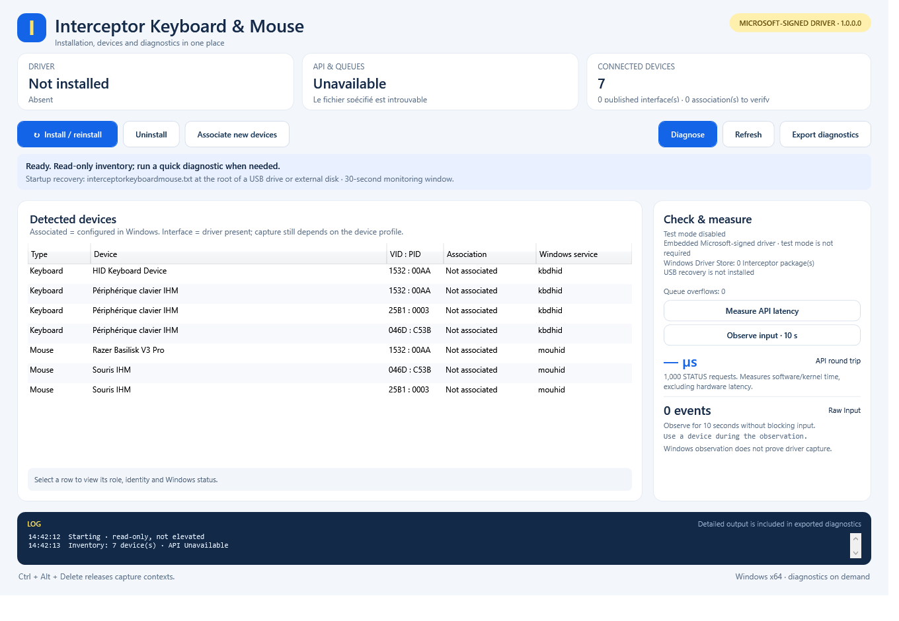
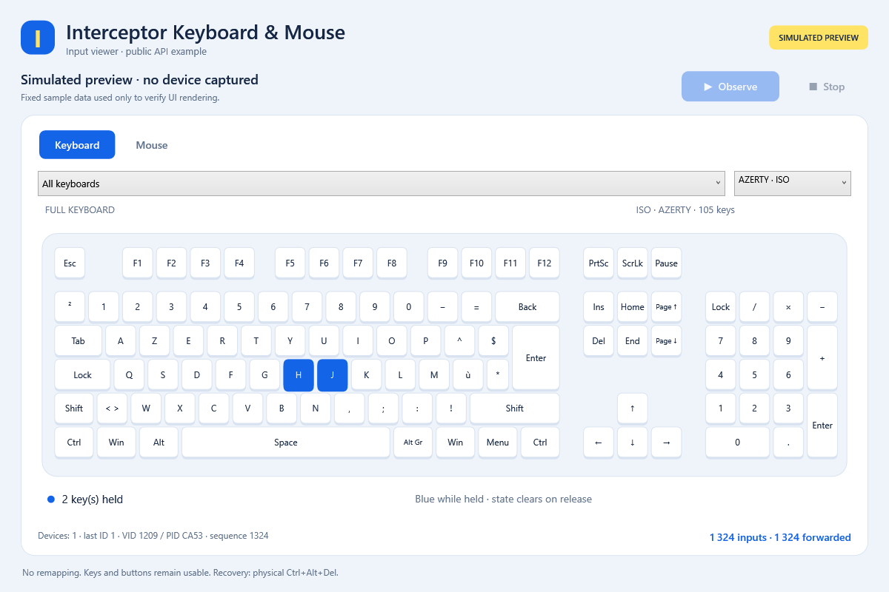

# Interceptor Keyboard & Mouse

<!-- simple-start:start -->
Read or change input from one keyboard or mouse, even when several are connected.

[First steps](#first-steps) · [Develop](#sdk-and-packages) · [Maintain](https://github.com/TitanCSA/sdk-packages/blob/main/CONTRIBUTING.md)

## First steps

**64-bit Windows 10 version 1709 or later, or Windows 11.**

If another Interceptor edition is installed, follow [the removal steps](docs/INSTALLATION.md) first.

1. Run [InterceptorSetup.exe](https://github.com/TitanCSA/Interceptor-Keyboard-Mouse/releases/latest/download/InterceptorSetup.exe) and choose **Install / reinstall**. If setup asks for a restart, restart Windows and reopen it.
2. Open [InterceptorExampleUI.exe](https://github.com/TitanCSA/Interceptor-Keyboard-Mouse/releases/latest/download/InterceptorExampleUI.exe).
3. Press a key or move the mouse. Check that your device appears in the viewer. Click **Stop** when you finish.
<!-- simple-start:end -->

<!-- full-version-contact:start -->
> [!IMPORTANT]
> **Version without the one-hour demo limit**
>
> In [Discord](https://discord.com/app), choose **Add Friend** and enter **`titancsa`**. Send the project name. Purchase details are sent privately.
<!-- full-version-contact:end -->

<details>
<summary>Project details and screenshots</summary>

Capture, remap or block **physical keyboard and mouse input** with a
**Microsoft-signed HID keyboard and mouse driver** and a **two-file C++17 SDK**.

Demo 1.0.5.4 replaces the Windows HID function driver on compatible devices, including supported devices whose original package is supplied by the manufacturer. Initialization and recovery work independently of input capture, and HID requests such as feature reports pass through to Windows HIDClass.
Identify each source, receive its input and forward your changes through the
device's Windows input path. Requires **Windows 10 1709+ / Windows 11 x64**.

**[Download](https://github.com/TitanCSA/Interceptor-Keyboard-Mouse/releases/latest)** |
[Installation](docs/INSTALLATION.md) | [C++ API](docs/API.md) |
[Examples](Examples/Console/README.md) | [Compatibility](docs/COMPATIBILITY.md)


| Setup and diagnostics | Input viewer |
| --- | --- |
|  |  |

Screenshots illustrate the interface; preview inputs are simulated.

</details>

<a id="quick-start"></a>

## Install and use


1. Download this repository's **InterceptorSetup.exe** and accept elevation.
2. Choose **Install / reinstall**. Use Windows **Restart** if requested, then
   reopen setup to finish device associations.
3. Run **InterceptorExampleUI.exe** and accept the administrator prompt.
   Observation starts automatically; tabs select keyboard or mouse.
   **Stop** releases capture. Close other capture applications first.
4. Use **Diagnose** for installation checks and a report you can copy or export.
   Input features that were not exercised remain **unverified**.

The GUI provides **Uninstall**. The console installer uses the same setup engine:

```powershell
.\InterceptorSetupConsole.exe /install
.\InterceptorSetupConsole.exe /uninstall
```

Exit code `3010` requests a restart; rerun `/install` afterward if associations
are pending. The driver package is Microsoft-signed; that signature does not
automatically sign installer or example EXEs. [Recovery](docs/INSTALLATION.md).

## How it works

For a spare keyboard used as a macro pad, see [selecting one keyboard](docs/SELECTED-KEYBOARD.md).
Before installing a capture driver, read the [security model and signing explanation](docs/SECURITY-MODEL.md):
the capture application can see sensitive input, and selecting one device in
an example is not a security boundary against other privileged software.

The driver uses supported Windows keyboard/mouse paths and HID mapper collections.
Input passes through normally until an application captures it. The application
receives scan codes, press/release flags, mouse movement, buttons and wheel data;
it can modify them, forward them or deliberately block individual events.
Closing the application releases capture. Physical **Ctrl+Alt+Delete** revokes
captures. Device/report limits are described in [compatibility](docs/COMPATIBILITY.md).

This edition provides **keyboard and mouse input only**. The separate
[Gamepad & Controller edition](https://github.com/TitanCSA/Interceptor-Gamepad-Controller)
can run alongside it, using its own service, SDK, recovery state and demo allowance.
Remove an overlapping combined [Interceptor](https://github.com/TitanCSA/Interceptor)
installation first. Use each edition's own SDK in its applications.

## Application examples and language wrappers

Choose a project for this **Keyboard & Mouse edition**:

| Project | Starting point |
| --- | --- |
| [AutoHotInterceptor](https://github.com/TitanCSA/AutoHotInterceptor) | AutoHotkey v1/v2 per-device subscriptions and an input monitor; adapted from evilC/AutoHotInterception. |
| [node-interceptor](https://github.com/TitanCSA/node-interceptor) | Node.js 20+/TypeScript wait, receive and send bindings; adapted from Rami-Sabbagh/node-interception. Install with `npm install interceptor-keyboard-mouse`; see its README for driver setup and examples. |
| [Keyboard & Mouse Remapper](https://github.com/TitanCSA/Keyboard-Mouse-Remapper) | A complete native C++ application with IGC scripts, visual rules and timed macros. |

The `interceptor-keyboard-mouse` package is the node-interceptor adapter with its `Interception` / `Device` API. The `interceptor-keyboard-mouse-sdk` package in the installation table below exposes this product SDK through its `Interceptor` API. Use the examples for the package you installed; their names and APIs are not interchangeable.

Close other capture applications, including monitors, before opening another
capture session. These projects share this edition's one-hour-per-kernel-boot
driver demo; a wrapper does not remove the limit. Read each project's license:
the Node wrapper is LGPL-3.0-or-later, while bundled stock AutoHotkey retains its
GPL-2.0 terms. Demo/evaluation driver source is documented in [driver/README.md](driver/README.md); full-version terms remain separate.

## C++ SDK and examples

**First SDK check.** Extract the [starter ZIP](https://titancsa.github.io/downloads/first-sdk-checks.zip) and run `python scripts/test_first_sdk.py interceptor-keyboard-mouse --run` from that folder. It reads the installed driver's status without opening a capture session. [Tools required](https://titancsa.github.io/guides/installer-and-sdk/).

Add [`Interceptor.h`](Interceptor/Interceptor.h) and
[`Interceptor.cpp`](Interceptor/Interceptor.cpp) to your Windows x64 C++17 project.
Compile the source once and include the header; no SDK DLL or prebuilt LIB is
required. Run capture applications as administrator.

The library manages the capture session automatically. Receive a batch with
`Get_Input_With_Timeout()`, read or change its typed entries, and forward it with
`Send_Input(inputs)`. Types, destinations and counts are automatic. Forward
unchanged events too: receiving removes them from the input queue.

The [console examples](Examples/Console/README.md) demonstrate key swaps,
typing, mouse-axis changes and deliberate input blocking. The graphical viewer
shows the same input families. [Complete API guide](docs/API.md).

<a id="downloads-and-source"></a>

## Downloads and build

Demo/evaluation driver source is available; see [driver/README.md](driver/README.md) for
build instructions and separate evaluation-source terms. Those terms apply to
Titan-authored driver code. Third-party source licenses and existing application/SDK
licenses remain applicable. Full/commercial implementation and private signing or
activation material are excluded.

The [latest release](https://github.com/TitanCSA/Interceptor-Keyboard-Mouse/releases/latest)
contains **InterceptorSetup.exe**, **InterceptorSetupConsole.exe**,
**InterceptorExampleUI.exe**, examples and source SDK ZIPs, and **SHA256SUMS.txt**.

For raw relative mouse movement, extract the examples ZIP and run
`09_Mouse_Move_Horizontal.exe` as administrator. Enter `300` or
`-485`, then press Enter to send that value directly as mouse X input.
See the [example instructions](Examples/Console/README.md#move-the-mouse-using-raw-relative-x-input).

```text
Interceptor/       The two-file C++ library
Examples/
  Console/         Seven keyboard/mouse examples
  UI/              Graphical input viewer
Installer/
  Console/         Console installer
  UI/              GUI, setup engine and compiled driver/recovery binaries
docs/ licenses/    Guides, screenshots and license terms
```

Build user-mode applications with Visual Studio 2022 C++ tools, a Windows SDK and
CMake: `powershell -ExecutionPolicy Bypass -File .\Build.ps1`.
Builds use the supplied signed driver and compiled recovery binaries.
**Demo/evaluation driver source is documented in [driver/README.md](driver/README.md).** [Build guide](docs/BUILD.md).
User-mode source is [MIT](LICENSE); driver binaries have
[separate terms](licenses/BINARY-LICENSE.txt).

<a id="one-hour-demo"></a>

## Demo edition

**One hour per Windows kernel boot**, starting with the first successful capture
and shared across this edition's applications. Sleep counts; closing, uninstalling
or reinstalling does not reset the allowance. Capture diagnostics can start it.
At expiry, capture/injection stop and physical input passes through normally.
Use Windows **Restart** for another allowance; Fast Startup shutdown does not
reset the kernel boot. [Contact titancsa on Discord](https://titancsa.github.io/about/evidence/#release-contact).

This independent project evolves the workflow popularized by
[oblitum/Interception](https://github.com/oblitum/Interception), with its own
implementation and API. It is not affiliated with oblitum or ABI-compatible with
the original. [Attribution](licenses/NOTICE).

## Minimal example: receive, read, forward

Install this edition first, restart if requested, and run your application as
administrator. Include `Interceptor.h`, compile `Interceptor.cpp` with your
application, and enable C++17. This example changes H to J and forwards every other input:

```cpp
#include "Interceptor.h"
#include <iostream>
#include <system_error>

int main() try {
    using namespace Interceptor;
    const auto init = Init_AllDevices();
    if (!init.ready) {
        std::cerr << "Initialization error: " << init.error
                  << ", restart required: " << init.reboot_required << '\n';
        return 1;
    }
    for (;;) {
        auto inputs = Get_Input_With_Timeout(1000);
        for (auto& input : inputs) {
            if (auto* key = input.Get<Keyboard_Input>()) {
                // make_code is the scan code; KeyUp marks a key release.
                if (!(key->stroke.flags & (KeyE0 | KeyE1)) &&
                    key->stroke.make_code == 0x23)
                    key->stroke.make_code = 0x24; // H becomes J.
            }
        }
        const auto sent = Send_Input(inputs);
        if (!sent) {
            std::cerr << "Send error: " << sent.error << '\n';
            return 1;
        }
    }
} catch (const std::system_error& error) {
    std::cerr << error.what() << '\n';
    return 1;
}
```

1. **Receive:** `Get_Input_With_Timeout(1000)` waits up to 1,000 milliseconds for
   input after initial context setup. Timeout returns an empty batch. The library
   creates and reuses the capture automatically; no context argument is needed.
2. **Read:** each `input` is one event. `input.type` gives its family, `input.device`
   its source ID within that family, and `inputs.size()` the event count.
   `input.Get<T>()` returns a pointer to that family's data or `nullptr`.
   Change typed fields before forwarding to modify an input; set
   `input.blocked = true` to block that event.
3. **Forward:** `Send_Input(inputs)` returns the batch to its source devices.
   Destination, type and count are automatic. Receiving consumes input, so
   forward unchanged entries too. `sent.accepted` gives the accepted count;
   `sent.error` is `0` on success. This basic example exits on a send error.

A batch borrows reusable storage: finish it before receiving another one.
Closing the application releases capture. See [API details](docs/API.md) for
field layouts, cancellation, errors and partial-send retries.

## Responsible use and disclaimer

This project, including its drivers, SDKs, libraries, applications, installers and examples, was created for lawful, constructive purposes such as accessibility, device customization, research, testing and software development. Illegal, malicious or unauthorized use is neither intended nor endorsed by TitanCSA or the contributors.

You are solely responsible for how you use, modify or distribute the software, for obtaining any necessary authorization, and for complying with applicable laws, third-party rights and service rules. TitanCSA and the contributors do not accept responsibility for users' actions, including illegal activity or misuse of the drivers or SDKs.

To the maximum extent permitted by applicable law, the software is provided "AS IS", without warranties of any kind, and TitanCSA and the contributors are not liable for claims, damages, data loss, system damage or other consequences arising from its use or misuse. Nothing in this notice excludes liability that cannot legally be excluded. Existing project and third-party license terms remain applicable.

<!-- central-sdk-packages:start -->
<a name="paquets-et-installation"></a>

## SDK and packages

Choose a language in the [SDK and package guide](https://github.com/TitanCSA/sdk-packages/tree/main/projects/Interceptor-Keyboard-Mouse#readme) for exact install commands and examples. If your example requires a driver or app, install it separately.

JavaScript and TypeScript: [`interceptor-keyboard-mouse-sdk`](https://github.com/TitanCSA/sdk-packages/tree/main/projects/Interceptor-Keyboard-Mouse/Interceptor-Keyboard-Mouse-JavaScript-npm#readme) · `npm install interceptor-keyboard-mouse-sdk@1.0.0`
<!-- central-sdk-packages:end -->


## Performance & Benchmarks

[Measured results and raw data](https://titancsa.github.io/TitanCSA-Benchmarks/interceptor/results/) · [Comparisons](https://titancsa.github.io/TitanCSA-Benchmarks/comparisons/) · [Methodology](https://titancsa.github.io/TitanCSA-Benchmarks/methodology/measurement/)

Virtual HID input crosses the tested filter and is checked by a separate Windows Raw Input receiver, with per-run PnP and capture evidence. These are publisher-operated Windows 11 Hyper-V software-path measurements, not physical USB latency or a universal speed ranking.

| Tested scope | Verified result |
|---|---|
| Virtual keyboard/mouse filter paths | 6 validated runs: forwarding, mouse remapping and controlled blocking |

**Vdevice benchmark status.** The original campaign recorded a controller teardown crash with demo 1.0.5.0. The signed 1.0.6.0 demo passed separate teardown tests. Commercial Vdevice qualification remains pending. [Incident and edition status](https://titancsa.github.io/TitanCSA-Benchmarks/methodology/incident-wdf-001/).

## Switching the input driver for one device

Setup and **Associate new devices** use the Interceptor mapper for compatible
HID keyboard and mouse instances, including original manufacturer INF packages
that use the Windows HID mapper. Setup records the original binding before it
changes a manufacturer package. The original package stays in the Driver Store.

The [C++ SDK](docs/API.md#switch-the-driver-for-a-keyboard-or-mouse) exposes `Get_Input_Driver_Bindings()` and
`Set_Input_Driver_Mode(instance, use_original)`. List the devices to obtain the
Windows HID instance ID. Close the capture session and run the switch with
administrator rights. The result is a Windows status code. Zero means ready.
3010 means restart Windows before resuming capture. The original mode stays
selected until you switch that instance back to Interceptor.

The installed recovery helper also supports these commands in an elevated
PowerShell. Replace the example ID with the exact value from the first command.

    .\InterceptorExample.exe --list-input-drivers
    .\InterceptorExample.exe --input-driver-mode original 'HID\VID_XXXX&PID_YYYY\INSTANCE'
    .\InterceptorExample.exe --input-driver-mode interceptor 'HID\VID_XXXX&PID_YYYY\INSTANCE'

Find the helper in the product's Recovery\Payload directory under Program Files.
If a physical device exposes several input instances, select each required
instance. If an old installation lacks a verified original binding, reinstall
the manufacturer's current driver before using the switch for that instance.
